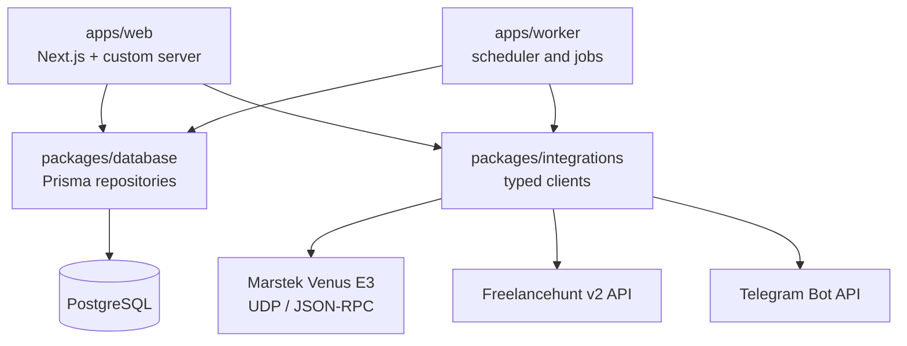
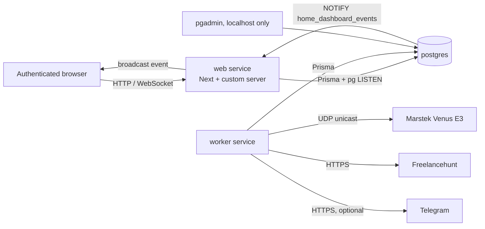
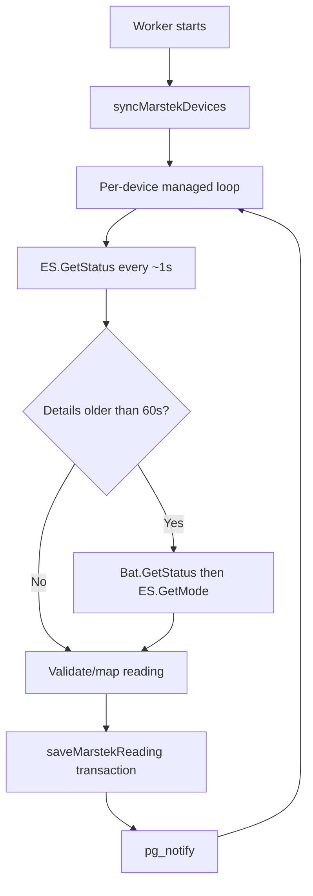
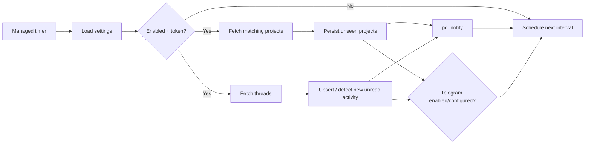

# Home Dashboard — Repository Guide for Agents

This file is the source of truth for agents working in this repository. Read the relevant sections before changing code. It describes the implemented system, its boundaries, operational constraints, and safe extension points as of October 2026.

## 1. Product and current capabilities

Home Dashboard is a self-hosted, authenticated dashboard for home energy telemetry and Freelancehunt monitoring. It runs locally through Docker Compose and keeps LAN-device access and external API secrets on the server side.

Implemented features:

- Local-user authentication. Public registration does not exist.
- Marstek Venus E3 monitoring over local UDP: live readings, historical charts, energy totals, device telemetry, and a time-to-empty estimate.
- A background worker that polls every configured Marstek device every second without overlapping polls for that device.
- Freelancehunt monitoring for filtered projects and unread message threads.
- Settings UI that loads the live Freelancehunt skill catalogue and persists only selected numeric skill IDs.
- Browser toast notifications and optional Telegram messages for new Freelancehunt projects/messages.
- Real-time refresh through PostgreSQL `NOTIFY` → authenticated WebSocket → browser, with a browser refresh fallback.
- PgAdmin as a local database UI.

Do not introduce the following without an explicit task: DTEK/weather/AI integration, public registration, multi-tenant roles, device-control actions, a queue, leader election, cloud deployment, or a second worker replica.

## 2. Stack and runtime

| Concern | Technology / convention |
| --- | --- |
| Monorepo | npm workspaces, TypeScript, Node.js 22 in containers |
| Web app | Next.js App Router, React, Tailwind CSS, shadcn/ui |
| Charts | Recharts |
| WebSocket server | Custom Node server, `ws`, PostgreSQL `LISTEN` |
| Worker | Node.js, `tsx`, `node-cron`, managed `setTimeout` loops |
| Database | PostgreSQL 17, Prisma 7, committed SQL migrations |
| Device transport | UDP/JSON-RPC to configured IPv4 Marstek hosts |
| External APIs | Freelancehunt v2 REST API and Telegram Bot API |
| Local deployment | Docker Compose |

Prefer existing packages and patterns. Ask before adding a framework, service, queue, deployment provider, state library, or architecture-level dependency.

## 3. Topology and dependency graph

### Package dependency direction



Hard boundaries:

- `apps/web` and `apps/worker` may import `@home-dashboard/database` and `@home-dashboard/integrations`.
- Shared packages must not import an app, React, Next.js, route handlers, or worker entrypoints.
- Web must not import worker jobs/schedules; worker must not import web route handlers/UI.
- Browser/client code must never access PostgreSQL, Marstek, or third-party secrets directly.
- Use workspace exports, never source-relative imports across packages.

### Runtime services



| Compose service | Role | Exposure / lifecycle |
| --- | --- | --- |
| `postgres` | Persistent database | Internal; `postgres_data` volume |
| `migrate` | Applies Prisma migrations | One-shot; web/worker wait for success |
| `web` | Next.js plus custom WebSocket server | `127.0.0.1:${WEB_PORT:-3000}` |
| `worker` | Marstek/Freelancehunt jobs | No public port; single replica assumption |
| `setup` | Creates initial user from environment | `tools` profile; one-shot |
| `pgadmin-passfile` | Writes PgAdmin passfile | One-shot helper |
| `pgadmin` | Local DB UI | `127.0.0.1:${PGADMIN_PORT:-5050}` |

Never expose PostgreSQL/PgAdmin publicly. Do not bind the dashboard beyond localhost without TLS and a proxy/auth review.

## 4. Repository map

```text
apps/
  web/
    src/app/                         # App Router pages, API routes, client UI
      api/auth/                       # login, logout, current-user endpoints
      api/freelancehunt/              # settings and skill catalogue routes
      api/marstek/                    # dashboard overview route
      dashboard/                      # dashboard, charts, project dialog, live updates
      login/                          # login page/form
      settings/                       # Freelancehunt settings page/form
    src/server/                       # server-only auth, input parsing, dashboard service
    src/server.ts                     # custom Next + WebSocket server
    scripts/create-user.ts            # initial-user CLI
  worker/
    src/index.ts                      # process lifecycle and scheduling
    src/jobs/marstek-poll.ts          # testable device polling job
    src/jobs/freelancehunt-poll.ts    # testable Freelancehunt job
packages/
  database/
    prisma/schema.prisma              # Prisma schema
    prisma/migrations/                # committed migration history
    src/client.ts                     # Prisma client/lifecycle
    src/users.ts                      # user repository
    src/marstek.ts                    # persistence, aggregation, events
    src/freelancehunt.ts              # settings, dedupe, persistence, events
  integrations/
    src/marstek.ts                    # UDP client, response validation/mapping
    src/freelancehunt.ts              # API client, validation, Telegram client
docker/
  web.Dockerfile
  worker.Dockerfile
  pgadmin/
docker-compose.yml
.env.example
AGENTS.md
```

| Change needed | Start with |
| --- | --- |
| Dashboard layout/tabs/mobile UI | `apps/web/src/app/dashboard/page.tsx`, `energy-dashboard.tsx` and adjacent components |
| Smooth number animation | `apps/web/src/app/dashboard/fade-value.tsx` |
| Dashboard data shape/chart sampling | `apps/web/src/server/marstek/dashboard.ts` |
| API security/input validation | route handler plus `apps/web/src/server/auth/*` |
| Settings UI and selected skills | `settings/freelancehunt-settings-form.tsx` |
| Freelancehunt HTTP/Telegram | `packages/integrations/src/freelancehunt.ts` |
| Freelancehunt dedupe/events | `packages/database/src/freelancehunt.ts`, worker job |
| Marstek protocol/mapping | `packages/integrations/src/marstek.ts` |
| Marstek persistence/retention | `packages/database/src/marstek.ts`, dashboard service |
| Poll timing/non-overlap/shutdown | `apps/worker/src/index.ts` |
| Browser real-time behavior | `apps/web/src/server.ts`, `dashboard/live-updates.tsx` |
| Database shape | schema plus new committed migration |

## 5. Authentication and request security

### Authentication model

- Users live in `users`; create them only through `npm run db:create-user` or the Compose `setup` service.
- Password handling is in `apps/web/src/server/auth/password.ts`; plaintext is never persisted.
- Login stores an HS256 JWT in `home_dashboard_session`.
- Session lifetime is 8 hours (`sessionLifetimeSeconds`).
- Cookie properties: `HttpOnly`, `SameSite=Lax`, `path=/`, conditionally `Secure`.
- JWT validation checks algorithm, issuer, audience, expiration and UUID subject, then checks the user still exists.

### Requirements for routes and state changes

- Protected pages/routes must call `currentUser()`.
- State-changing HTTP routes must also use `sameOrigin()` from `server/auth/http.ts`.
- Bound and parse untrusted JSON. Existing convention: maximum 4096 bytes unless a justified endpoint needs another limit.
- Return explicit error JSON. Never expose password hashes, tokens, database URLs, or untrusted upstream payloads.
- WebSocket upgrade requires a valid session cookie and exact same-origin `Origin`/`Host` match.

## 6. Web application

### Pages

| URL | Behavior |
| --- | --- |
| `/login` | Login form |
| `/dashboard` | Protected dashboard with Energy and Freelancehunt tabs |
| `/dashboard?tab=freelancehunt&page=N` | Server-side paginated projects and project dialog |
| `/dashboard?device=ID&range=H` | Selected Marstek device and predefined range |
| `/dashboard?from=YYYY-MM-DD&to=YYYY-MM-DD` | Custom UTC range; max 90 days and never future |
| `/settings` | Protected Freelancehunt monitoring settings |

Default to Server Components. Existing focused client components:

- `live-updates.tsx`: WebSocket, toast notifications, 250 ms refresh debounce, reconnect backoff 1–30 seconds.
- `freelancehunt-projects.tsx`: responsive project listing and accessible details dialog.
- `range-controls.tsx`: predefined/custom ranges.
- `marstek-charts.tsx`: Recharts charts.
- `fade-value.tsx`: vertical 200 ms numeric rollover; it cleans up timers/animation frames and avoids a full fade blink.

Use shadcn components in `apps/web/src/components/ui`, semantic controls, focus states, empty/error/loading states, Tailwind theme tokens, and responsive layouts. Narrow screens must retain usable tab navigation, forms, tables, and dialogs.

Login, dashboard and settings share the dark graphite palette through `dashboard-theme` on the root layout. Shared colors live in `globals.css`; `dashboard-shell` adds the subtle background accent, including on login/settings. Keep portalled dialogs and toast notifications consistent with this theme.

### Dashboard composition

`getMarstekDashboard()` is the server-side composition point. It:

1. Reads configured devices and newest measurement per device.
2. Defines online as enabled with a measurement younger than 3 minutes.
3. Chooses requested device, otherwise first enabled, otherwise first available.
4. Loads selected-device historical buckets for requested/custom range.
5. Samples chart points to approximately 400 maximum.
6. Returns fleet overview, latest selected telemetry, points, energy totals, and range bounds.

Predefined `DashboardRange`: `1`, `6`, `24`, `168`, `720` hours (1 h, 6 h, 24 h, 7 d, 30 d). Keep `/api/marstek/overview` validation aligned if ranges change.

Historical buckets are 60 seconds for ≤24 h and 600 seconds above that. Do not pass raw one-second rows to multi-day charts.

### Time to empty

```text
minutes_to_empty = remaining_capacity_Wh / current_discharge_W × 60
```

- `remainingCapacityWh` is the latest device reading; `dischargePowerW` is the non-negative output magnitude.
- Estimate renders only above 0.5 W discharge and is bounded to 365 days; otherwise `—`.
- It assumes unchanged load/current usable capacity and is not a BMS prediction.
- The top battery-overview card is the primary placement; do not create conflicting duplicate calculations. It keeps the duration in a single fixed-height row with separate day/hour/minute units.

## 7. Real-time event pipeline

```mermaid
sequenceDiagram
  participant W as Worker
  participant R as Database repository
  participant PG as PostgreSQL
  participant S as Custom web server
  participant B as Browser
  W->>R: save reading/project/thread
  R->>PG: transaction + pg_notify(home_dashboard_events, JSON)
  PG-->>S: LISTEN notification
  S-->>B: authenticated WebSocket broadcast
  B->>B: toast where applicable; debounced router.refresh()
```

Channel name is exactly `home_dashboard_events`. Payloads must remain compact JSON and backward-compatible.

| Event | Producer | Browser action |
| --- | --- | --- |
| `marstek.measurement.saved` | `saveMarstekReading` | Debounced refresh |
| `freelancehunt.project.discovered` | `saveFreelancehuntProjects` | Toast/Open action, refresh |
| `freelancehunt.message.discovered` | `saveFreelancehuntThreads` | Toast/Open action, refresh |
| `connection.ready` | custom server | Connection acknowledgement only |

`apps/web/src/server.ts` runs Next and `ws` together. It owns PostgreSQL `LISTEN`, reconnection after failure, 30-second socket pings and graceful shutdown. Do not replace this with a Next route handler: WebSocket upgrades depend on this custom-server arrangement.

For a new event:

1. Persist/deduplicate state first.
2. `pg_notify` inside the same transaction.
3. Do not include secrets or oversized data.
4. Narrow payloads defensively in client code.
5. Keep server-rendered HTTP data as source of truth; the socket is invalidation/notification only.

## 8. Marstek integration

### Configuration and connectivity

`MARSTEK_DEVICES` is a JSON array:

```json
[{"id":"venus-e3-1","name":"Venus E3","host":"192.168.3.224","port":30000}]
```

`parseMarstekDevices()` permits up to 32 unique entries and validates:

- ID: lowercase alphanumeric plus `_`/`-`, 1–64 chars.
- Name: non-empty, max 100 chars.
- Host: IPv4 only.
- Port: integer `1..65535`.

The system sends direct UDP unicast. Docker Desktop broadcast discovery is not reliable; test reachability from the actual Docker host.

### Polling flow



- Scheduling belongs in `apps/worker/src/index.ts`; reusable transport is integrations and persistence is database.
- Each device schedules next work only in the previous run's `finally`, preventing overlap.
- `pollMarstekDevices()` processes devices in groups of four.
- Main status client: 800 ms timeout, one attempt. Details use a longer retrying client, cached for 60 seconds to preserve one-second status cadence.
- Failure records `lastError`; identical failures log no more than once per minute. Timeouts must not stop worker.
- Startup upserts/enables configured devices and disables removed ones.
- Retention runs at 03:17 UTC, deleting readings older than 90 days.

### Units and semantics

| Field group | Contract |
| --- | --- |
| `socPercent` | `0..100` |
| `batteryPowerW` | Positive charging, negative discharging |
| `chargePowerW` / `dischargePowerW` | Non-negative directional values |
| `powerSource` | `reported`, `derived`, `unavailable`; label derived values honestly |
| Grid/PV/off-grid/meter values | Instantaneous watts, nullable |
| Capacity and cumulative totals | Watt-hours, nullable |
| Temperature | Celsius, nullable |
| `flow` | ±20 W threshold: charging/discharging/idle |
| Mode/flags | Nullable when optional RPC does not provide them |

Directional energy uses trapezoidal integration:

```text
energy_Wh = (previous_power_W + current_power_W) / 2 × elapsed_hours
```

Integration is skipped after gaps above 5 minutes, so outages never create invented energy.

### Add a Marstek metric

1. Identify firmware field and unit.
2. Validate/map it in `packages/integrations/src/marstek.ts` and `MarstekReading`.
3. Add migration + repository selections when persistence is needed.
4. Add dashboard response/UI with null handling.
5. Add parser tests for valid, missing, and invalid values.

Never add device-control methods without explicit scope, strong validation, authorization, and safety UX.

## 9. Freelancehunt and Telegram

### Client behavior

`FreelancehuntClient` in `packages/integrations/src/freelancehunt.ts` is the sole v2 client.

- Base URL: `https://api.freelancehunt.com/v2`.
- Auth: `Authorization: Bearer <FREELANCEHUNT_API_TOKEN>`.
- `Accept-Language: uk`; request timeout 10 seconds via `AbortController`.
- `429` normalizes to `freelancehunt_rate_limited`.
- All upstream responses are structurally narrowed before becoming domain objects.

Projects call `filter[skill_id]` with comma-separated selected IDs. Persist IDs, not names. Settings fetch live readable names and groups from `/v2/skills`.

### Settings model

Singleton row is `freelancehunt_settings.id = "default"`.

| Field | Meaning |
| --- | --- |
| `enabled` | Master switch; worker returns early when false or API token absent |
| `projectPollingEnabled` | Poll project list |
| `messagePollingEnabled` | Poll threads/unread messages |
| `telegramEnabled` | Send Telegram only when token/chat ID exist |
| `pollIntervalSeconds` | Valid `10..3600`; worker minimum next delay is 5 s |
| `skillIds` | ≤50 distinct positive numeric IDs |
| `projectsInitialized`, `messagesInitialized` | Baseline: first successful batch persists but never notifies |

Default IDs preserve original filters: `103, 120, 121, 169, 175, 180, 183, 190, 24, 86`.

Do not make Freelancehunt one-second polling without a rate-limit design. A cycle can call both projects and threads; Marstek's one-second cadence is separate and intentional.

### Poll/dedupe/notification flow



Projects deduplicate by `external_id`. The baseline batch creates database rows but emits no event. Later unseen projects persist, notify browser, and optionally produce Telegram messages.

Threads upsert by `external_id`. After baseline, notification requires unread status plus a changed message count or last-post time.

Telegram uses `sendMessage`, a 10-second timeout, compact text + URL, and no secret logging. Failed delivery fails the containing poll job and is visible in worker logs; do not claim successful delivery when it fails.

### Endpoints

| Endpoint | Method | Security / purpose |
| --- | --- | --- |
| `/api/freelancehunt/settings` | `GET` | Authenticated singleton settings |
| `/api/freelancehunt/settings` | `PUT` | Authenticated, same-origin, ≤4 KiB, validated update |
| `/api/freelancehunt/skills` | `GET` | Authenticated fresh skill list, no-store cache |
| `/api/marstek/overview` | `GET` | Authenticated bounded device/range JSON overview |
| `/api/auth/login` | `POST` | Bounded credentials input; sets cookie |
| `/api/auth/logout` | `POST` | Session logout |
| `/api/auth/me` | `GET` | Current authenticated user |
| `/api/events` | WebSocket | Same-origin valid JWT session |

`{ "error": "freelancehunt_not_configured" }` means the web container lacks `FREELANCEHUNT_API_TOKEN`. Set it in private `.env`, then rebuild/restart relevant Compose services; never hard-code it.

## 10. Database

### Prisma conventions

- Schema: `packages/database/prisma/schema.prisma`.
- Generated client: `packages/database/generated/client`; never hand edit it.
- Shared client/lifecycle: `packages/database/src/client.ts`; worker shutdown calls `disconnectDatabase()`.
- Migrations: `packages/database/prisma/migrations/<timestamp>_<description>/migration.sql`.
- Compose runs `prisma migrate deploy` in dedicated `migrate` service.
- Never use `prisma db push` as production migration workflow.

### Models

| Model | Key/indexes | Purpose |
| --- | --- | --- |
| `User` | UUID ID, unique login | Local identity |
| `MarstekDevice` | Config ID | Metadata, enabled state, last seen/error |
| `MarstekMeasurement` | BigInt; `(deviceId, sampledAt DESC)`, `sampledAt` | Time-series readings + interval energy |
| `FreelancehuntSettings` | singleton `default` | Monitoring switches/filters/baselines |
| `FreelancehuntProject` | unique external ID, `discoveredAt DESC` | Project feed |
| `FreelancehuntThread` | unique external ID, `(isUnread,lastPostedAt DESC)` | Thread change state |

All historical timestamps are `timestamptz` / UTC `Date`. New time-series access must include suitable device/time indexing. Put persistence, dedupe, transactions and `pg_notify` in `packages/database`; do not duplicate Prisma/SQL in apps.

## 11. Environment configuration

Never commit `.env`, tokens, passwords, credentials, or private local values. Keep `.env.example` complete.

| Variable | Used by | Notes |
| --- | --- | --- |
| `POSTGRES_PASSWORD` | Compose | Required; Compose builds internal database URL |
| `AUTH_JWT_SECRET` | web | Required, at least 32 UTF-8 bytes |
| `INITIAL_USER_FIRST_NAME`, `INITIAL_USER_LAST_NAME`, `INITIAL_USER_LOGIN`, `INITIAL_USER_PASSWORD` | setup | Initial user; password must be 12+ chars |
| `WEB_PORT`, `PGADMIN_PORT` | Compose | Local host ports; defaults 3000/5050 |
| `PGADMIN_DEFAULT_EMAIL`, `PGADMIN_DEFAULT_PASSWORD` | pgadmin | Local admin credentials |
| `MARSTEK_DEVICES` | worker | JSON device list |
| `FREELANCEHUNT_API_TOKEN` | web + worker | Enables skills endpoint and monitoring |
| `TELEGRAM_BOT_TOKEN`, `TELEGRAM_CHAT_ID` | worker | Both needed for Telegram delivery |
| `DATABASE_URL` | application processes | Compose injects it; direct local commands need it |
| `HOSTNAME`, `PORT` | custom web server | Defaults `0.0.0.0:3000`; Compose sets hostname |

Web receives Freelancehunt token because settings load skills. Worker receives Freelancehunt/Telegram credentials because it polls/notifies. Secrets must never appear in browser code or database rows.

## 12. Local development and operations

### Commands

| Command | Purpose |
| --- | --- |
| `npm run dev` | Next web dev server |
| `npm run dev:worker` | Worker via `tsx` |
| `npm run typecheck` | Generate Prisma client and type-check workspaces |
| `npm run lint` | Web ESLint |
| `npm test` | Auth, integrations and worker-job tests |
| `npm run build` | Workspace builds |
| `npm run db:generate` | Prisma client generation |
| `npm run db:migrate` | Apply committed migrations |
| `npm run db:create-user` | Create local user from environment |
| `docker compose up -d --build` | Full stack build/start |
| `docker compose up -d --build web` | Rebuild web after web/UI code change |
| `docker compose ps` | Inspect service health |
| `docker compose logs -f worker` | Inspect poll/notification logs |

URLs: `http://127.0.0.1:3000` dashboard; `http://127.0.0.1:5050` PgAdmin.

### Safe local setup

1. Copy `.env.example` to private `.env`; set passwords/secrets.
2. `docker compose up -d --build`.
3. After migrations, create a user with `docker compose --profile tools run --rm setup` or `npm run db:create-user` in a configured environment.
4. Log in, then configure Freelancehunt settings only after token is injected into both web and worker.
5. Confirm Marstek LAN/UDP reachability from Docker host.

### Diagnostics

| Symptom | First checks |
| --- | --- |
| Battery missing/data stale | `MARSTEK_DEVICES`, worker logs, physical LAN UDP path, `lastError` |
| `marstek_poll_failed` | Timeout is tolerated; verify IP/port/firmware/LAN, not broadcast discovery |
| No live dashboard refresh | Confirm custom `server.ts`, PostgreSQL listener, same-origin authenticated socket |
| Skills endpoint fails | Check web token; 503 `freelancehunt_not_configured` is expected when absent |
| No Freelancehunt alerts | Master/sub switches, baseline, token, interval, selected IDs, worker logs, API limits |
| No Telegram alert | Settings switch, worker token/chat ID, bot channel permission |
| New project not shown | Filter match, baseline, persistence, or pagination |

## 13. Testing and verification

Existing tests cover auth (`apps/web/src/server/auth/*.test.ts`), Marstek/Freelancehunt integration parsing, and Marstek polling job behavior. Tests must not require a real battery, external credentials, Telegram, or production database.

Before handoff:

1. Run focused relevant tests first.
2. Run `npm run typecheck` after TypeScript/schema/package-boundary changes.
3. Run `npm run lint` after web/TSX changes.
4. Run `npm test` for integrations, auth, scheduling, parsing, or broad changes.
5. Rebuild affected Docker services and check `docker compose ps` for runtime/deployment changes.
6. For live-event work, verify full path: authenticated WebSocket, database `NOTIFY`, client receipt/refresh.

## 14. Implementation standards

### General

- Prefer strict TypeScript, small modules, explicit package-boundary types.
- Validate external API/device data and all HTTP input at boundaries.
- Model unavailable device data as `null`; UI must handle it honestly.
- Structured logs need context but never secrets/unbounded upstream payloads.
- Preserve API/event compatibility unless breaking change is explicitly requested.
- No unsolicited refactor, dependency addition, restructure, formatting sweep, commit, push, PR, external message, or secret mutation.

### Web

- App Router APIs belong in `apps/web/src/app/api/**/route.ts`.
- Keep routes thin: auth, input validation, service/repository call, explicit response.
- Use Server Components by default; client components only for interactivity/browser APIs.
- Keep pagination server-side/bounded and charts aggregated/sampled.

### Worker

- Keep scheduling/process lifecycle in worker; reusable logic in shared packages.
- Catch/report errors per job so one integration failure never kills worker.
- Preserve non-overlap. Do not replace managed loops with unsafe intervals.
- Never run multiple replicas without database-backed leader/locking.
- Do not call web HTTP just to execute local work.

### Database and integrations

- Schema changes require migration, repository mapping, types and indexes in same cohesive change.
- Store units/retention consistently with dashboard aggregation.
- `pg_notify` only after persistent state in same transaction.
- Configure hosts/tokens/timeouts through environment, with bounded retries only when safe.
- Marstek calls remain direct unicast and sequential per device.

## 15. Change playbooks

### External integration

1. Confirm credentials, rate, read/control scope.
2. Build validated client in `packages/integrations`.
3. Add repositories/migrations only if persistence is needed.
4. Add safe worker job if polling is needed.
5. Add protected web/API/UI layer.
6. Add compact event through existing PostgreSQL/WebSocket path only if live UX needs it.
7. Update `.env.example`, Compose wiring, tests, and this guide when architecture materially changes.

### Freelancehunt filter/settings change

1. Continue persisting numeric IDs, not display names.
2. Continue fetching names/groups dynamically for readable settings UI.
3. Update settings type/validation, schema/migration if needed, route, UI and worker together.
4. Reassess upstream rate limit before adding calls or lowering interval.

### Live-notification change

1. Persist and dedupe before notifying.
2. Notify only meaningful post-baseline changes.
3. Keep events minimal; client narrows them.
4. Treat Telegram configuration as a separate optional delivery path.

## 16. Agent workflow and definition of done

1. Start with `git status --short`; preserve existing user changes. A dirty tree is normal.
2. Use `rg`/`rg --files` to identify smallest relevant area; avoid dumping unrelated code.
3. Read neighboring contracts before changing public types, events, schema, or environment variables.
4. Make the smallest cohesive change in correct package boundary.
5. Use `apply_patch` for edits. Never reset/clean/overwrite unrelated work.
6. Verify proportional to risk using Section 13.
7. Do not commit/push/create PR/send messages unless user explicitly requests it.
8. End with concise Ukrainian summary: changed items, checks actually run, remaining limitation.

Done means applicable code is in right boundary, types/tests pass or gap is stated, inputs/secrets are safe, migration/config wiring exists when required, worker stays safe, and local service is rebuilt when user expects to see the result.
